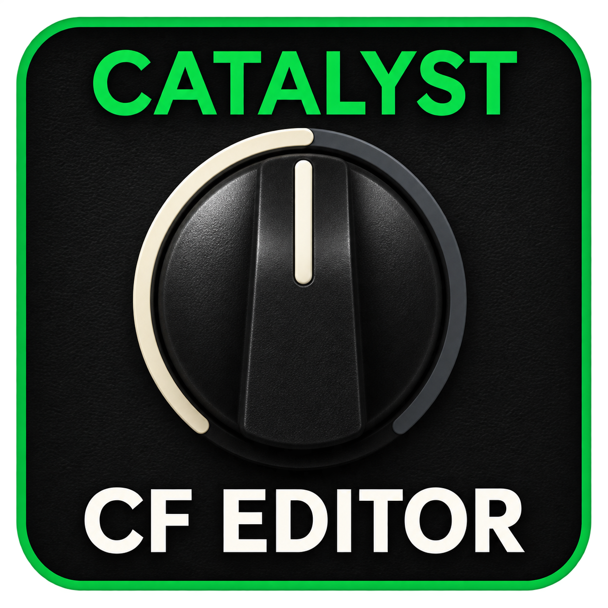
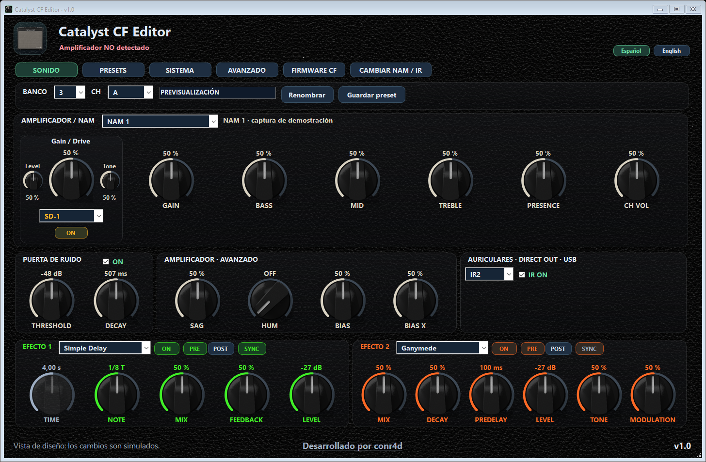
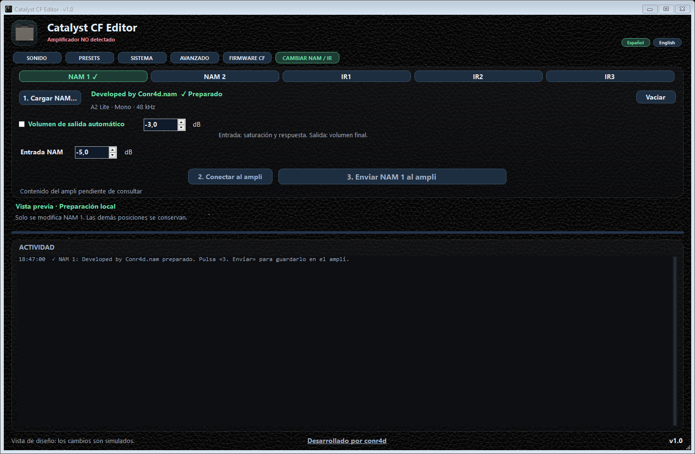

# Catalyst CF Editor

**Español** · [English](README.md)

Una aplicación para Windows que reúne el editor del Catalyst y la carga de
**dos NAM A2 Lite y tres IR**. El audio se procesa dentro del amplificador,
sin necesitar un plugin de audio en el ordenador.

**v1.0 · Experimental**

[Descargar CatalystCFEditor.exe — v1.0](https://github.com/conr4d86/Catalyst-CF-Editor/releases/download/v1.0.0/CatalystCFEditor.exe) ·
[Uso](docs/USO.md) · [Recuperación](docs/RECUPERACION.md)

Descarga **CatalystCFEditor.exe** desde Releases y ábrelo en Windows. La aplicación,
el Custom Firmware y los ejemplos están incluidos en un solo EXE. Si Windows no
reconoce el amplificador, instala su controlador oficial desde [Descargas de Line 6](https://line6.com/software/).

Sin un CF compatible confirmado, solo está habilitada FIRMWARE CF. Las otras
pestañas se desbloquean al reconocer el receptor y se vuelven a bloquear si se
pierde la conexión. El identificador CATALYST-CF-XXXXXXXXXXXX usa la edición del
firmware y no muestra el identificador privado del amplificador.

## Qué incluye

- Edición de amplificador/NAM, Gain, EQ, volumen, puerta de ruido y parámetros avanzados.
- Boost de fábrica y aproximaciones propias EP Boost, 808 y SD-1; Drive, Level, Tone y ON/OFF.
- Dos efectos con selección por tipología, PRE/POST y sincronización de tempo.
- Gestión de presets, copias, ajustes globales, pedal de expresión, afinador y TAP/BPM.
- Instalación inicial del Custom Firmware con dos NAM y tres IR de prueba incluidos.
- Cambio individual de NAM o IR por USB, sin reinstalar todo el firmware.
- Interfaz Español/English, escala proporcional y un único EXE.

## Primera instalación

Cierra los otros gestores de Line 6, conecta el Catalyst por USB y espera la
sincronización. En **FIRMWARE CF**, pulsa **Instalar Custom Firmware**.
No necesitas seleccionar archivos: los ejemplos vienen integrados. La app
verifica una copia de los doce presets antes de la instalación. Mantén el
USB y la alimentación conectados hasta que termine y reinicia normalmente
cuando lo indique y pulsa **Comprobar arranque**. **Reinstalar Custom Firmware**
crea una edición nueva y activa los cinco ejemplos incluidos. Los recursos anteriores
quedan archivados, sin migración automática; conserva tus archivos NAM e IR
originales para volver a enviarlos.

Si ya tienes instalado el motor corregido incluido aquí, esta actualización del
host solo requiere sustituir el EXE. Si la app indica que un CF anterior necesita
actualizarse, esa ruta reutiliza una copia local verificada de los presets de la
misma edición instalada, sin seleccionarlos repetidamente. Si falta o no coincide,
se detiene antes de transferir firmware. Consulta las [preguntas frecuentes](docs/FAQ.md).

Esta revisión habilita la instalación inicial en **Catalyst 60/CX60**. El
código contempla 100/200, pero no hay pruebas físicas en esos modelos y su
instalación inicial permanece deshabilitada.

## Cambiar NAM / IR

Con el CF compatible instalado, abre la pestaña principal **CAMBIAR NAM / IR**:

1. Elige **NAM 1, NAM 2, IR1, IR2 o IR3** y carga o arrastra el archivo.
2. Pulsa **2. Conectar al ampli**.
3. Pulsa **3. Enviar** a la posición elegida y espera la confirmación.

Solo cambia esa posición; las demás se conservan. **Vaciar** elimina la
selección local, no el contenido del amplificador. Vuelve a **SONIDO** para
editar y guardar el preset. Seleccionar o cargar un archivo no lo envía por sí solo.

NAM admite **A2 Lite, mono, 48 kHz**. **Entrada NAM** es ajustable y empieza en
**−5 dB**: modifica la saturación y la respuesta de la captura. El volumen de
salida es independiente, automático o manual; empieza en manual a **−3 dB**.
Estos ajustes se aplican al enviar el NAM. Gain y el preamp también modifican
la saturación. Los IR decodificables se convierten a mono/48 kHz/2.048 muestras;
se ofrecen volumen automático/manual y cortes ajustables de **80 Hz y 8 kHz**.
El archivo original no se modifica.

NAM actúa por el altavoz y las salidas directas. Los IR corresponden a
**auriculares, Direct Out y USB**; no sustituyen el altavoz físico.

## Pruebas y recuperación

El CF corregido se transfirió a una unidad 60/CX60 de desarrollo; el usuario confirmó
arranque normal y sonido, y los diagnósticos de lectura avanzaron sin fault registrado.
El host r106 pasó trece grupos locales sin abrir SDK ni USB. La regresión del control
nativo cubre doce modelos en emulación. El usuario confirmó cambios físicos con
CH A/B, con las apps cerradas y sin perder el sonido. También confirmó A → B → A
desde el editor, con audio y controles funcionando. Siguen pendientes el guardado
del preamp, la persistencia tras apagar y encender y la matriz completa de hardware;
consulta el [informe de validación](docs/VALIDACION.md).
No se garantiza ausencia de fallos ni compatibilidad física con 100/200.

Lee [Uso](docs/USO.md), [Recuperación](docs/RECUPERACION.md) y
[Estado de las pruebas](docs/VALIDACION.md) antes de instalar.
El EXE no está firmado; comprueba su procedencia y la huella publicada.

Desarrollado por **conr4d**. Proyecto independiente, sin afiliación oficial con Line 6.

[GitHub](https://github.com/conr4d86/Catalyst-CF-Editor) · [Buy me a coffee](https://buymeacoffee.com/conr4d)

[Inicio rápido](docs/INICIO_RAPIDO.md) · [Preguntas frecuentes](docs/FAQ.md) ·
[Compilación desde fuentes](docs/BUILDING.md) · [Créditos y componentes](NOTICE)
