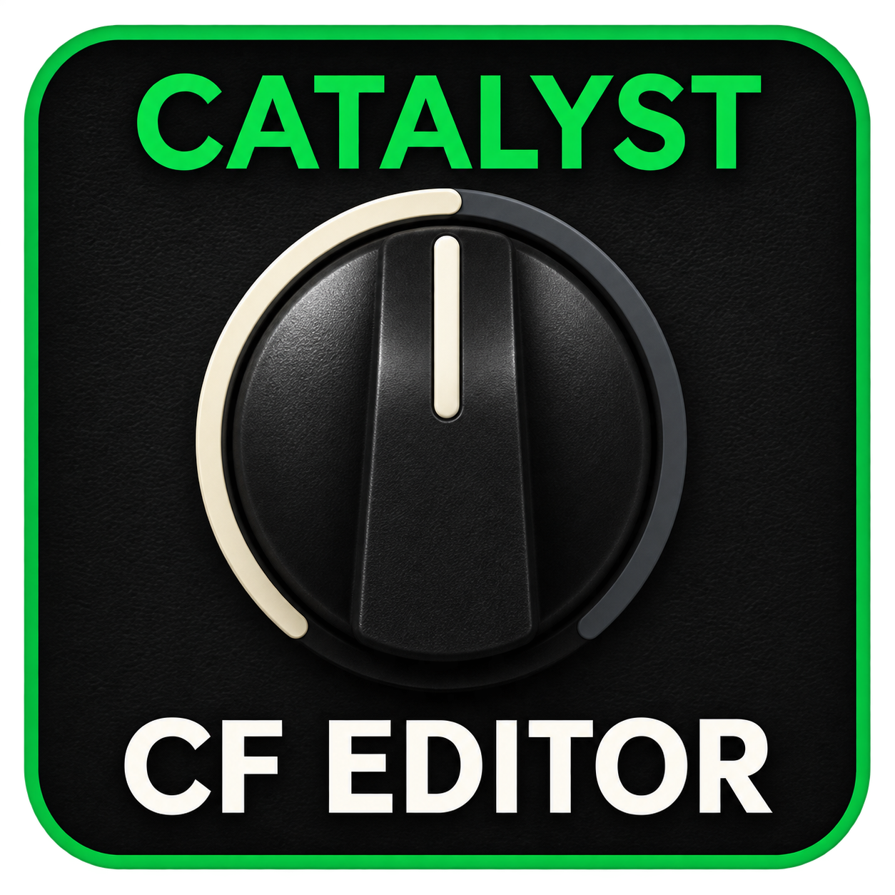
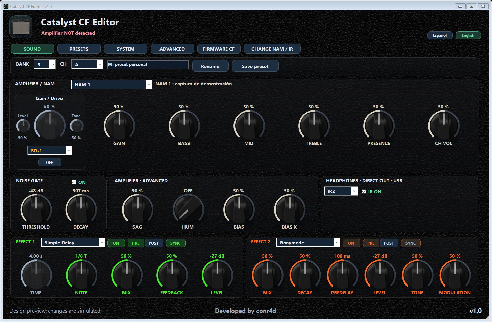
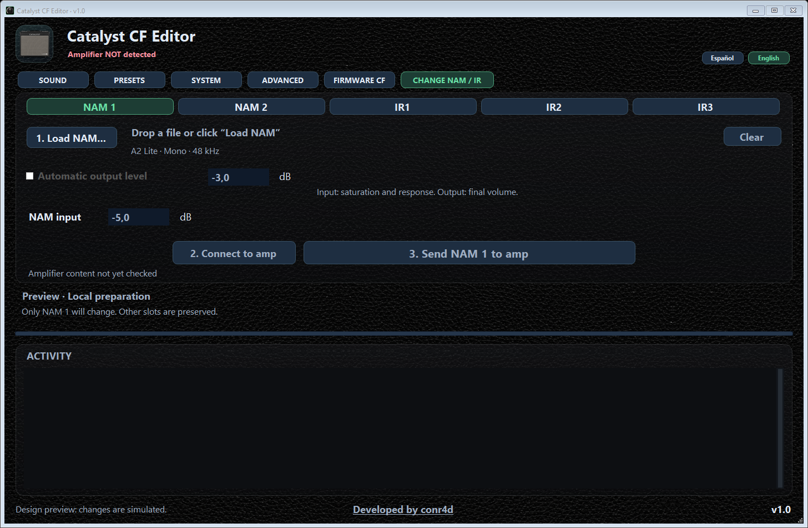

# Catalyst CF Editor

[Español](README.es.md) · **English**

A single Windows application for editing the Catalyst and loading **two NAM A2 Lite
captures and three cabinet IRs**. Audio runs inside the amplifier, without a PC audio plugin.

**v1.0 · Experimental**

[Download CatalystCFEditor.exe — v1.0](https://github.com/conr4d86/Catalyst-CF-Editor/releases/download/v1.0.0/CatalystCFEditor.exe) ·
[Usage](docs/USO.md) · [Recovery](docs/RECUPERACION.md)

Download **CatalystCFEditor.exe** from Releases and run it on Windows. The application,
Custom Firmware and example files are included in one EXE. If Windows does not
recognize the amplifier, install its official driver from [Line 6 Downloads](https://line6.com/software/).

Until compatible CF is verified, only FIRMWARE CF is enabled. Other tabs unlock
after the receiver is recognized and lock again when the connection is lost.
The CATALYST-CF-XXXXXXXXXXXX label comes from the firmware edition, without
exposing the amplifier's private device identifier.

## Features

- Amplifier/NAM, Gain, EQ, volume, noise gate and advanced controls.
- Factory Boost and original EP Boost, 808 and SD-1 approximations; Drive, Level, Tone and ON/OFF.
- Two effects, category selectors, PRE/POST and tempo sync.
- Preset management, backups, system settings, expression pedal, tuner and TAP/BPM.
- One-button initial Custom Firmware installation with two demo NAMs and three demo IRs.
- Individual NAM/IR uploads over USB without a full firmware reinstall.
- Spanish/English interface, proportional scaling and one EXE.

## Initial installation

Close other Line 6 managers, connect by USB and wait for sync. Open **FIRMWARE CF**
and press **Install Custom Firmware**. Demo files are included; no file selection is
needed. The app verifies a twelve-preset backup first. Keep power and USB connected
until completion, then restart normally when prompted and click **Verify startup**.
**Reinstall Custom Firmware** creates a new edition and activates all five included
examples. Previous resources remain archived, without automatic migration; keep
your original NAM and IR files to upload them again.

If the corrected engine included here is already installed, this host update only
requires replacing the EXE. If the app reports that an earlier CF needs an update,
its upgrade path reuses a verified local preset backup for that exact installed
edition, without repeatedly selecting presets. A missing or mismatched backup
stops that path before firmware transfer. See the [FAQ](docs/FAQ.md#english).

Initial installation is enabled for **Catalyst 60/CX60** in this revision.
100/200 handling exists in code, but these models have not been physically tested;
their initial installation remains disabled.

## Change NAM / IR

With compatible CF installed, open the main **CHANGE NAM / IR** tab:

1. Select **NAM 1, NAM 2, IR1, IR2 or IR3** and load or drop a file.
2. Click **2. Connect to amp**.
3. Click **3. Send** and wait for confirmation.

Only the chosen position changes. **Clear** clears the local selection, not the
amplifier's stored file. Return to **SOUND** to edit and save your preset.
Choosing or loading a file does not start its upload.

NAM requires **A2 Lite, mono, 48 kHz**. **NAM Input** is adjustable and defaults to
**−5 dB**, affecting the capture's saturation and response. Output level is independent,
supports automatic or manual mode, and defaults to manual **−3 dB**. These settings
are applied when uploading the NAM. Gain and preamp controls also affect saturation.
Decodable IRs are converted to
mono/48 kHz/2,048 samples. IR level can be automatic or manual, with adjustable
**80 Hz / 8 kHz** cuts. Original files are not modified.

NAM affects the speaker and direct outputs. Cabinet IRs apply to **headphones,
Direct Out and USB**, without replacing the physical speaker.

## Validation and recovery

The corrected CF has been transferred to one development 60/CX60; the user confirmed
normal startup and sound, and read-only diagnostics progressed without a recorded
fault. The r106 host passed thirteen local test groups without SDK/USB access.
The native control-owner regression covers twelve models in emulation.
The user confirmed physical CH A/B changes with all apps closed and continuing
audio. GUI A → B → A switching was also confirmed with working audio and controls.
Preamp-save/cold-boot persistence and the full hardware matrix remain pending;
see the [validation report](docs/VALIDACION.md).
No zero-failure or physical 100/200 compatibility claim is made.

Read [Usage](docs/USO.md), [Recovery](docs/RECUPERACION.md) and
[Validation](docs/VALIDACION.md) before installation. The EXE is unsigned;
check its source and published hash.

Developed by **conr4d**. Independent project; not officially affiliated with Line 6.

[GitHub](https://github.com/conr4d86/Catalyst-CF-Editor) · [Buy me a coffee](https://buymeacoffee.com/conr4d)

[Quick start](docs/QUICKSTART.md) · [FAQ](docs/FAQ.md) ·
[Building from source](docs/BUILDING.md) · [Credits and component notices](NOTICE)
